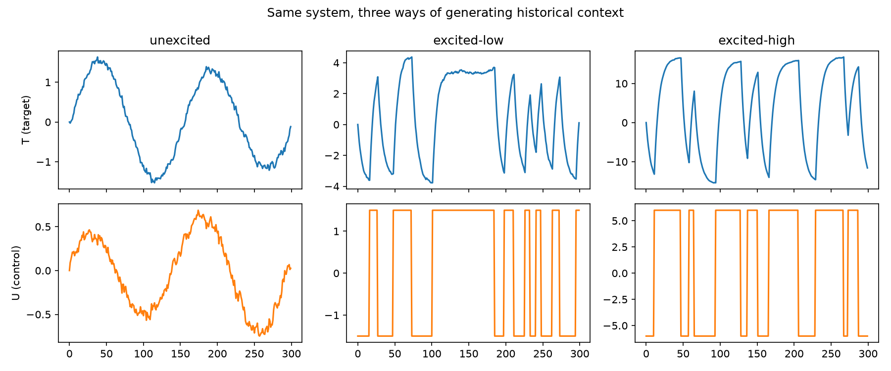
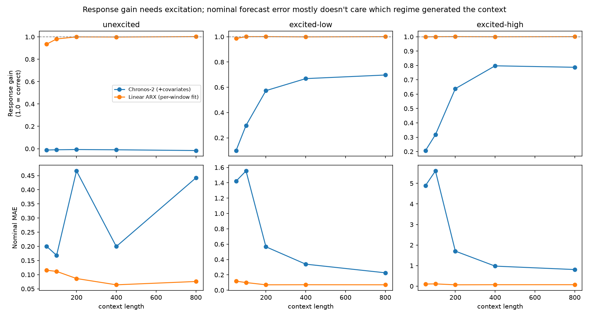
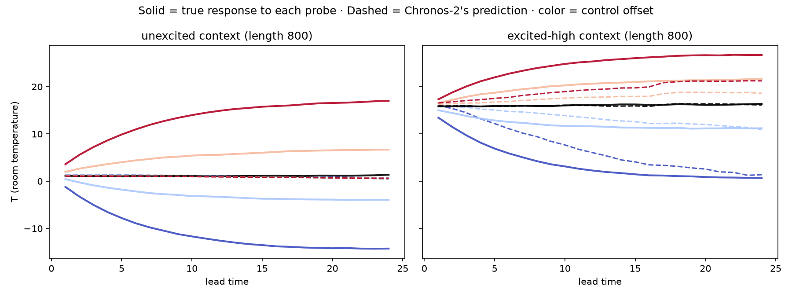

<!--
PUBLISHED: https://medium.com/@eclow/can-your-forecast-predict-the-effect-of-a-decision-7205e481a0d9
Status tracked in topics/backlog.md (published, post: excitation-for-control).
This file is kept as a historical record of what was published, not an
actively-edited draft.

Numbers and figures are from a one-off full-scale sweep (context lengths
50/100/200/400/800, 20 repeats per setting) — see
results/02-excitation-for-control/metrics/excitation_sweep_*_fullscale.csv
and the _fullscale figures. The committed notebook itself still defaults to
SMALL_SCALE=True (fast dev/CI run); regenerating these exact numbers means
flipping that flag and rerunning, or using the standalone sweep script the
draft was produced from.
-->

# Does a Good Forecast Mean the Model Understands the Lever?

I've spent the last couple of posts asking some version of the same question: is a
pretrained forecast *accurate*, and is it accurate enough to earn its complexity over
something simpler? That question has an implicit assumption baked into it, one I hadn't
noticed until I ran into a NeurIPS workshop paper almost by accident: that forecast
accuracy is the thing worth measuring in the first place.

Here's the question this post asks instead: *if a model's forecast closely matches what
a system actually did, does that mean the model understands how the system responds to
being controlled — or just what the system's existing behavior looks like?*

Those sound like they should be the same thing. They aren't, and the gap between them
turns out to be easy to miss and, once you know to look for it, easy to demonstrate.

## The paper that started this

The paper is Amria et al. (2026), ["Time-series Foundation Models for Predictive
Control: The Role of Excitation"](https://arxiv.org/abs/2610.06447), presented at a
NeurIPS workshop. The setup: residential heat-pump control. A time-series foundation
model — Chronos-2, the same model I've used in earlier posts — forecasts a building's
indoor temperature. It's good at this. Give it the history of temperature, heat-pump
supply setpoint, and weather, and it predicts next-day temperature about as well as a
purpose-built linear model, sometimes better.

Then the authors ask the obvious follow-up question for anyone actually trying to use
this for *control*: if you change the candidate setpoint — ask "what would the room do
if I ran the heat pump 6 degrees hotter?" — does the forecast's answer change correctly?

Under the model's normal operating history, the answer is close to no. The forecast
barely moves. It's still highly accurate on the trajectory the real controller actually
took; it's just not *sensitive* to a hypothetical change in that controller's plan. Only
when the historical data contains deliberately randomized, system-independent variation
in the control signal — what the paper calls **excitation** — does the forecast start
responding correctly to a changed plan. Fine-tuning and some clever feature engineering
reduce how much excitation is needed. They don't eliminate the need for it.

That's a genuinely useful, slightly uncomfortable finding if you're the kind of person
who's been quietly assuming "forecasts well" and "models the mechanism" are close enough
to the same thing. I wanted to see whether I could make the effect concrete and small
enough to hold in my hands.

## Why this one isn't built on real data

Every demo in this series so far has run on real series — hourly CISO electricity
demand, daily SPY prices. This one doesn't, for a reason that's worth being upfront
about rather than working around: testing whether a forecast responds *correctly* to a
hypothetical intervention requires knowing what would *actually* have happened under that
intervention. History only runs once. Neither CISO demand nor SPY's closing price has a
"control input" I can counterfactually change and then check against — there's no ground
truth to score against.

So: a small synthetic system. Not because synthetic is a lesser or safer choice in
general — the rest of this series deliberately avoids it, because real data is where the
interesting mess is — but because this specific question can't be asked of real data at
all. The paper's own authors hit the same wall; most of their results come from a
building simulator too, with one real-building check that explicitly can't be scored
(their words: "the house ran once").

## The toy system

Think of a single room with a heater. The temperature next step depends on the
temperature now, how hard the heater's running, and the weather outside:

`T` is room temperature — what we're forecasting. `U` is the controllable heater input.
`D` is the weather — real, but not something anyone's controlling. All three of those
numbers (0.85, 0.4, 0.1) are just made up; what matters is that the system is linear and
I get to choose it, which means I also get to know, exactly, what would happen under any
control sequence I feed it.

I generate historical data for this toy room two different ways:

- **Unexcited.** A simple thermostat-style controller: heat more when the room's below
  target, less when it's above, tracking a target that drifts slowly over time (so the
  controller has real, non-trivial work to do — this isn't a degenerate "sits at zero and
  never moves" case). The control signal here is a *deterministic function of the room's
  own state and the time of day*. Watching it tells you almost nothing about the system
  you couldn't already infer from the temperature itself.
- **Excited.** The control signal ignores the room entirely and instead follows a
  randomized step pattern — jump to some level, hold it for a random stretch, jump again
  — independent of what the temperature is doing. This is the APRBS signal from the
  paper (amplitude-modulated pseudo-random binary sequence, if you want the full name),
  used for exactly this purpose in classical system identification since long before
  anyone was pretraining anything.

Same system underneath, two very different kinds of history to learn from.

You can see the difference by eye before measuring anything: the unexcited control signal
(left) is a smooth, slow mirror of the temperature trace above it — of course it is, it's
reacting to that temperature. The excited signals (middle, right) are chunky and
uncorrelated with anything the room is doing.

## Asking whether the forecast knows the lever

Here's the test, borrowed directly from the paper (their Eq. 3): start from one shared
context and current state, then construct several **matched probes** — candidate futures
that differ only in what control you tell the model to assume, holding everything else
(weather, starting temperature) fixed. For each probe, actually simulate what the true
system would do — I can do this because I built the system, so I know its exact
dynamics — and separately ask the forecaster to predict it.

Center both sets of trajectories on their own average across probes (this cancels out
anything the model gets right or wrong *regardless* of which control you asked about —
including a model that's just confidently, consistently wrong about the baseline level).
What's left is the part of the prediction that's actually trying to track the
intervention. Regress the predicted version of that against the true version, pooled
across every probe and every step of the forecast horizon, and you get one number: the
**response gain**.

- **Gain near 1** — the forecast moves correctly when you change the control.
- **Gain near 0** — the forecast barely reacts to the control at all, whatever else it's
  doing.

Accuracy and gain are different axes. A model can nail the trajectory that actually
happened and still score zero here, because gain only measures the part of the
prediction that responds to the thing you changed.

## Results: gain needs excitation. Accuracy doesn't care.

I ran this for both an unexcited and two levels of excited context ("low" and "high"
amplitude), at context lengths from 50 up to 800 steps, comparing two forecasters: Chronos-2
(given the control and weather as known covariates, past and candidate future) against a
linear model fit fresh on each context window.

**Under unexcited context, Chronos-2's gain stays at essentially zero, at every context
length I tried.** -0.01 at 50 steps of context, -0.01 at 100, -0.01 at 200, -0.01 at
400, -0.02 at 800. The standard errors are tight enough (0.001-0.003, over 20 repeats) to
say this small negative number is real and not just noise centered on zero — but it's
real *and negligible*: nowhere close to the 0.1-0.8 range gain reaches once there's any
excitation at all. More history doesn't help, either — five context lengths spanning
50 to 800 steps and the number never moves. The model has plenty of data; what it
doesn't have is data that *varies independently of what it's trying to predict*, and
apparently that's the thing that actually mattered.

**Under excited context, gain climbs with both context length and excitation
amplitude** — from 0.10 at the shortest context up to 0.70 at the longest under low
excitation, and from 0.21 up to a peak of 0.80 (at 400 steps) under high excitation.
It doesn't cleanly climb forever, either: high excitation's gain actually dips slightly
from 0.80 to 0.79 between 400 and 800 steps of context, well within noise, but a reminder
this isn't a tidy monotonic story — more context and more excitation help, but even the
best setting here tops out around 0.8, not a clean 1.0.

**Nominal forecast accuracy tells close to the opposite story.** At 400 steps of
context, unexcited has the *best* nominal accuracy of the three regimes (MAE 0.20) and
the *worst* gain (-0.01); high excitation at the same context length has the *worst*
nominal accuracy (MAE 0.98 — about 5x worse) and by far the best gain (0.80). The regime
where Chronos-2 is most accurate about what already happened is the regime where it's
least correct about what would happen under a change. That's the entire point made
concrete: these are different axes, and optimizing or evaluating only one of them tells
you nothing about the other.

One example, zoomed in — a single window, longest context, unexcited versus the most
excited regime, five probes each:

Under unexcited context (left), the five dashed prediction lines barely separate from
each other, while the five solid true-outcome lines fan out a lot — the model is
predicting roughly the *same* future regardless of which control you told it to assume.
Under excitation (right), the dashed lines start to fan out the same direction as the
solid ones, even if not by quite as much.

## A baseline with a head start, and I'm saying so

The linear model in this comparison isn't a neutral baseline, and it would be dishonest
to present it as one. I built the toy system to be linear, and the baseline is a linear
model fit directly to that functional form — it only has to *estimate three numbers*
from the context, not discover that the relationship is linear in the first place. Its
gain sits in a tight band around 1 everywhere I measured it — roughly 0.93 to 1.00, with
a couple of settings drifting a hair above 1.00, well within estimation noise — including
the unexcited regime
at every context length — the one setting where it has the least excuse to do well,
since it's seeing the same uninformative control signal Chronos-2 is. It barely needs
excitation at all, which mostly tells you that *if you already know the right model
class*, you don't need much of it to fit it.

That's not a knock against the comparison — it's informative in its own right. The gap
between Chronos-2 and the linear model, where it exists, is a gap between "needs to
discover the structure from data" and "was handed the structure for free." Some of what
looks like Chronos-2's weakness here is really the ordinary cost of not knowing the
answer in advance — a cost the paper's own, considerably less artificially-advantaged
linear baseline also pays, just more slowly.

## What this doesn't show

A few things worth saying plainly, since overclaiming here would undercut the actual
point:

- This is a linear, three-parameter, fully-known toy system. It is not a building, a
  market, or a grid, and nothing here says how large this effect is, or whether it's
  this clean, in a real deployment — that's exactly the caveat the source paper places on
  its own, considerably more realistic, simulation, and it applies at least as much
  here.
- I tested one model (Chronos-2) in one mode (zero-shot, given covariates). The paper
  also studies fine-tuning and multi-scale control features, both of which reduce how
  much excitation is needed without eliminating it — I didn't rebuild that part, so I
  can't tell you whether this toy system would show the same pattern.
- Nothing here touches closed-loop control — actually running a controller that uses
  these forecasts to pick actions, the way the paper's own preliminary closed-loop
  section does. This is strictly an open-loop, forecast-only comparison.
- The numbers above are means over 20 independently sampled windows per setting. Standard
  errors on Chronos-2's gain estimates are small relative to the unexcited-vs-excited gap
  (mostly under 0.04, well under the 0.1-0.8 spread that gap covers) — it isn't a fluke
  of which windows got drawn — but 20 repeats on a 3-parameter toy system is still a toy
  sample size, not a benchmark.

## The takeaway

A forecast that's accurate about what a system did isn't the same claim as a forecast
that understands what the system *would do*, and nothing about being right on the first
one guarantees anything about the second. That's easy to agree with in the abstract and
apparently easy to miss in practice — accurate enough is a seductive stopping point, and
"accurate on history" is the only thing most forecast evaluation actually measures,
including, until I built this, every demo in this series.

If you're using a forecast to decide what to *do* rather than just to know what's coming,
the question isn't just "how good is this forecast" — it's "has this model ever seen
what happens when the thing it's conditioning on moves independently of everything else."
If the answer is no, a good backtest won't tell you, and you may be about to find out the
hard way instead.

---

*Code, the full sweep, and the toy system are in
[`notebooks/02-excitation-for-control/`](https://github.com/ec78/slective-hybrid-forecasting/tree/main/notebooks/02-excitation-for-control)
of the [companion repo](https://github.com/ec78/slective-hybrid-forecasting). The paper
that prompted this is Amria, Hoffmann, Bordne, Rothenhäuser, Frison, Walnum, Gros, &
Bödecker (2026), "Time-series Foundation Models for Predictive Control: The Role of
Excitation," NeurIPS 2026 Workshop: TS-LIMITS.*
