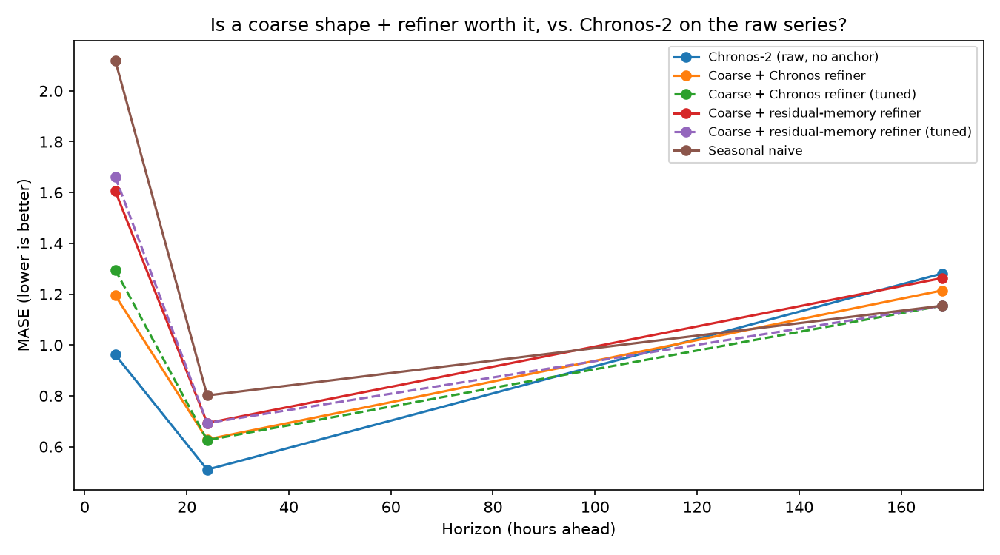
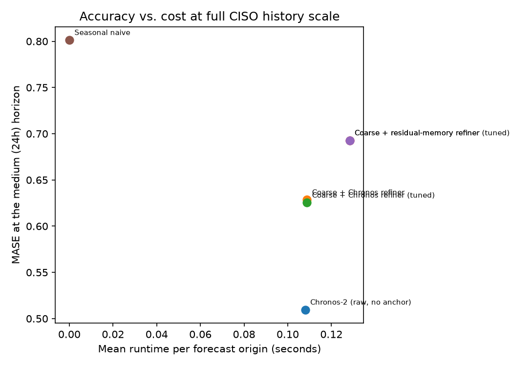

<!--
DRAFT — not yet published. Status tracked in topics/backlog.md
(in-progress, post: coarse-to-fine-hybrids).

Numbers are from the full-scale sweep (n=56 origins per horizon), not the
notebook's SMALL_SCALE=True smoke-test numbers (n=6). See
results/03-coarse-to-fine-hybrids/metrics/coarse_to_fine_summary_fullscale.csv
and the _fullscale figures. The committed notebook itself still defaults to
SMALL_SCALE=True; regenerating these exact numbers means flipping that flag
and rerunning, or using the standalone sweep script this draft was produced
from.
-->

# Is the Expensive Refiner Worth It?

There's a pattern showing up across a bunch of recent LLM-based forecasting papers: don't
ask the expensive model to predict everything from scratch. Let something cheap sketch
the big picture first — the trend, the seasonal shape — and spend the expensive model's
effort only on filling in what's left. It's an appealing idea, and it's the premise this
post actually tests, in miniature, on this repo's own CISO electricity series.

Short answer, before the method: **no, not here.** Keep reading for why that's more
interesting than it sounds.

## The paper behind this

SCALER (Le et al., 2026, KDD — `literature/scaler-2026.pdf`) is where I picked this up. A
lightweight Transformer predicts a coarse future shape; a pretrained LLM then refines it
scale by scale, spending its (expensive) attention only on the parts the coarse model
left out. It's a real, trained system — a custom coarse-shape model feeding a
frozen-but-adapted LLM through a multi-stage token-refinement loop, with its own loss
function, trained on standard long-horizon benchmarks. Not something to reproduce in a
blog post.

What I *can* test at small scale is the underlying bet: that an expensive model's job
gets easier, and cheaper, once a cheap model has already removed the easy-to-predict
structure. This repo already has everything needed to try it honestly, without building
anything new and expensive:

- **Coarse shape:** seasonal-naive (Post 01) — free.
- **Cheap refiner:** the nearest-neighbor residual-memory retrieval from Post 01 Demo 2,
  pointed at the coarse model's residual instead of ARIMA's.
- **Expensive refiner:** Chronos-2 zero-shot (Posts 01-02), pointed at that same residual
  series instead of the raw target.
- **The thing to beat:** Chronos-2 zero-shot on the raw series, no coarse anchor at all —
  just Post 01 Demo 1's model, reused as-is.

If the premise holds, a cheap shape plus *either* refiner should get close to — or beat —
Chronos-on-raw, and the cheap refiner should do it for a fraction of the cost.

## A bad sign, early

Before building the full evaluation, I ran a handful of individual forecast origins by
hand to sanity-check the mechanism. There was no consistent winner at all — on one
origin the coarse-plus-refiner combination beat raw Chronos by a wide margin, on the next
origin it lost badly. That's not a result, it's noise from looking at too few examples —
exactly why this needs the full rolling-origin harness rather than eyeballing a few
windows. But it was a fair warning that this wasn't going to be a clean story either way.

## Results: no, at every horizon, tuned or not

Both refiners ran two ways: full-strength (adding 100% of the predicted residual back to
the coarse forecast), and at a scale chosen on validation data, per horizon, before ever
touching test — the same validation-only discipline every notebook in this series uses.

**At full strength, both refiners make things worse than Chronos-on-raw, at every
horizon.** MASE for Chronos-2 on the raw series: 0.96 (short), 0.51 (medium), 1.28
(long). Coarse + Chronos-refiner, full strength: 1.19, 0.63, 1.21. Coarse +
residual-memory refiner, full strength: 1.61, 0.69, 1.26. Not close, and not in the
direction the premise needed.

**Tuning the correction strength doesn't rescue it.** At the short horizon, tuning
actually made both refiners *worse* on test (1.30 and 1.66, versus 1.19 and 1.61 at full
strength) — the validation-selected weight (0.75 for both) fit validation noise that
didn't hold up, a reminder that "tuned on validation" isn't a guarantee, just a
discipline. At the medium horizon, tuning barely moves anything (0.63 → 0.625 for the
Chronos refiner; no change at all for the residual-memory refiner, which validation
already wanted at full strength). At the long horizon, both tuned refiners land exactly
on plain seasonal-naive's number (1.15) — because validation data selects a refinement
weight of **zero** there. That's not the method working. That's validation correctly
figuring out there's nothing useful to add, and falling back to the cheap baseline
instead.

## A plausible reason why

SCALER's refiner is a general-purpose LLM, adapted for forecasting but without native
time-series pretraining — it plausibly benefits a lot from being handed an explicit shape
to anchor to, because it doesn't reliably infer long-horizon seasonal structure on its
own. Chronos-2 is a different kind of model: a time-series specialist, pretrained
specifically to recognize exactly this sort of structure. Post 01 already showed it
picking up CISO's daily and weekly shape zero-shot, no hints required. Handing it a coarse
shape it was already capable of inferring doesn't give it new information — there's no
free lunch left for the refiner to collect. This is a guess at the mechanism, not
something this notebook proves directly, but it's consistent with everything above: the
one model built specifically to understand temporal shape is exactly the one model this
trick doesn't help.

## The twist: the "cheap" refiner wasn't cheap

This is the part I didn't expect going in. The residual-memory refiner doesn't call an
external pretrained model, so the obvious assumption is that it's the cheap option. It
isn't, not at this repo's full CISO history. `retrieve_residual_correction` does a
brute-force nearest-neighbor search over every valid candidate window in the training
history — tens of thousands of them, at full scale — and that search gets slower as the
history grows. By the time I ran the full sweep, the residual-memory refiner's average
runtime per forecast (0.128s) was *higher* than a single Chronos-2 call (0.108-0.109s).
"No pretrained model involved" turned out not to mean "cheap" — it meant "cheap at the
small scale I originally tested it at in Post 01," which is a different and much weaker
claim.

(One bookkeeping note that caught me off guard while building this: the combination
helper this series reuses for validation-tuned weights — `combine_results` — zeroes out
the reported runtime for blended rows, because in Posts 01 and 02 a reader could look up
each underlying model's own cost separately. Here, with "tuned" and "untuned" versions of
the *same* model sitting right next to each other in the same table, that convention would
have made tuning look free. It isn't — tuning just reweights a forecast that was already
computed, so the tuned row costs exactly what the untuned row costs. Fixed before writing
any of the numbers above; worth mentioning because it's a reminder that a cost claim is
only as honest as the code computing it, and it's easy to inherit a convention from code
that made sense in a different context without rechecking whether it still does.)

## What this doesn't show

- One series (CISO), one coarse model (seasonal-naive — the Fourier-regression option
  from Post 01 Demo 3 wasn't tried here), one implementation of each refiner. A different
  coarse model, or a refiner with access to more structure, might tell a different story.
- This isn't a test of SCALER itself, which is a trained, task-specific architecture —
  only of the general principle it's built on, at small scale, with off-the-shelf pieces.
- n=56 origins per horizon is a real improvement over this series' usual smoke-test
  scale, but it's still one series over one historical window, not a benchmark suite.
- The mechanism explanation above — that Chronos-2 doesn't need the help because it
  already understands the shape — is a reasonable guess given what Post 01 already
  showed, not something directly tested here. A model that's weaker at zero-shot
  seasonality might show a different result with exactly this same setup.

## Takeaway

The selective part of "selective hybrid forecasting" cuts both ways. Sometimes combining
a cheap model with an expensive one earns its keep — see Post 01's validation-weighted
hybrid, which did help at some horizons. Sometimes it doesn't, and the honest version of
that story is worth telling too, especially when it comes with a finding nobody was
looking for: the piece you assumed was free wasn't, once you actually measured it instead
of taking the "no pretrained model involved" shortcut. Checking the premise turned out to
matter more than checking the result.

---

*Code, the full sweep, and both refiners are in
[`notebooks/03-coarse-to-fine-hybrids/`](https://github.com/ec78/slective-hybrid-forecasting/tree/main/notebooks/03-coarse-to-fine-hybrids)
of the [companion repo](https://github.com/ec78/slective-hybrid-forecasting). The paper
that prompted this is Le, Tran, Luo, Aickelin, Phung, & Le (2026), "Efficient Test-Time
Scaling for LLM-based Time Series Forecasting," KDD 2026.*
